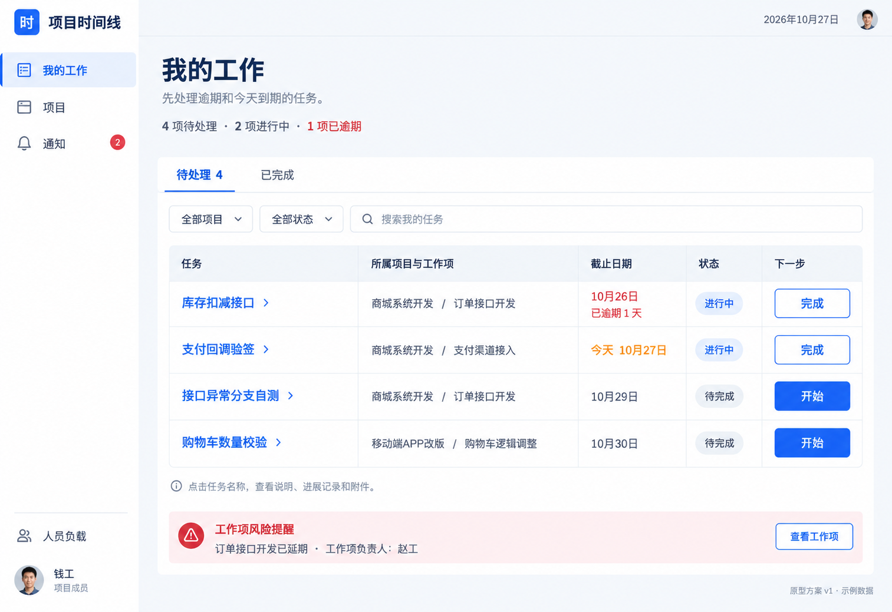
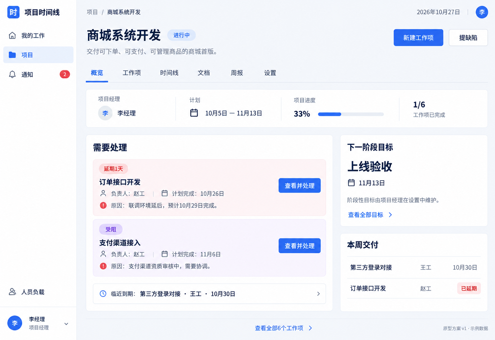
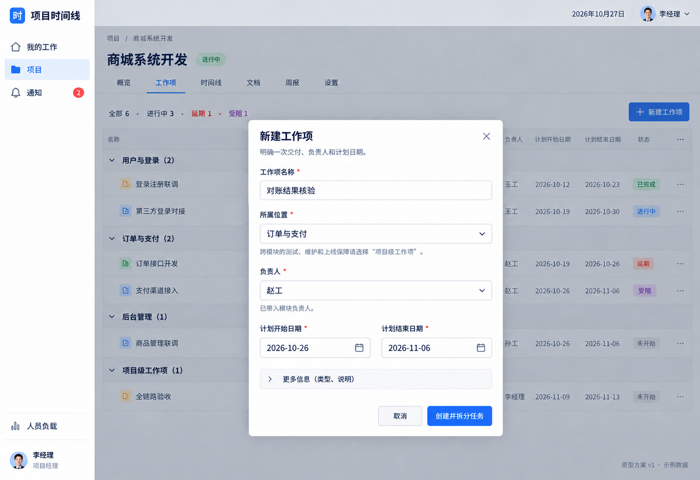
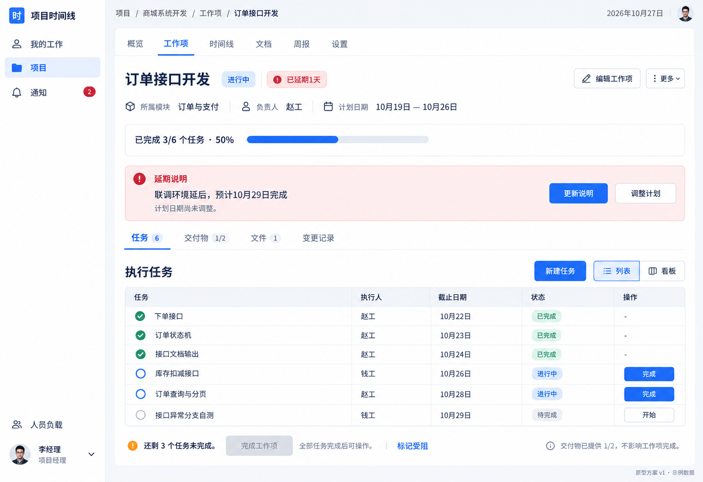
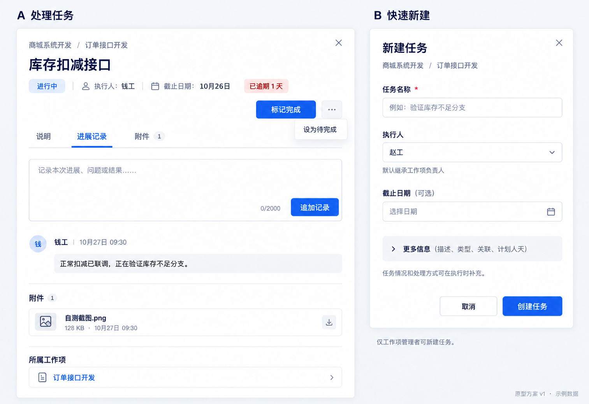
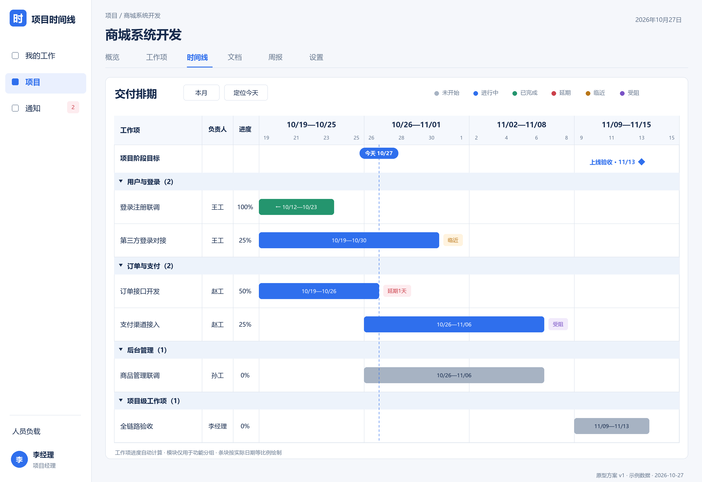
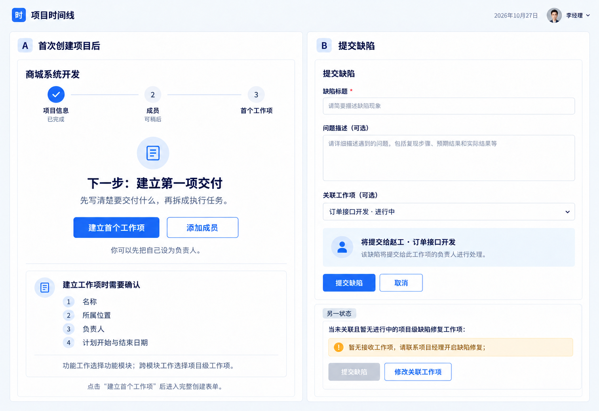
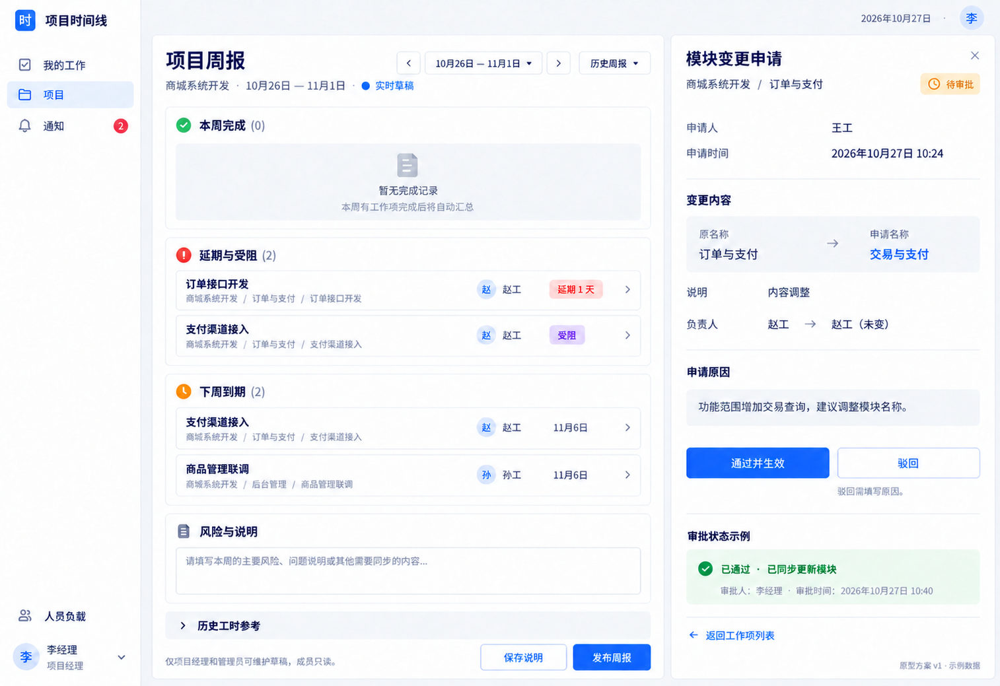

# 项目时间线 · 体验改善设计方案 v1

日期：2026-10-27 ｜ 状态：设计评审稿 ｜ 交付：产品方案、静态原型与流程说明

本稿承接 [用户体验走查与简化建议](用户体验走查与简化建议.md)。本轮按用户要求先设计，不实现功能。图中账号、项目、数量和日期均为统一的示例数据，不代表当前数据库。正式业务契约仍以现有需求、接口设计和项目记忆为准；本稿列出的改善行为是下一阶段的设计目标。

本轮已确定的是“先交付改善文档与原型、暂不写代码”的工作范围；导航和交互方案为待评审设计，尚未替换现行产品契约。

原型入口：[原型图册与流程导览](../prototype/ux-v1/README.md)。下文用 P01—P08 对应原型，用 F01—F08 对应完整使用流程。

## 1. 产品要帮助用户完成什么

**让小团队知道：谁在什么时候交付什么，哪里卡住了，下一步由谁处理。**

成员每天打开系统，先找到分给自己的工作；负责人围绕一次交付拆任务、处理风险、确认完成；项目经理和只读管理者能直接看出近期交付与异常。

| 当前问题 | 这版设计的具体回应 | 判断是否改善 |
|---|---|---|
| 登录后只看到项目统计 | 普通用户默认进入“我的工作”，展示本人任务 | 不知道任务层级也能找到工作 |
| 创建入口分散 | 项目内统一“新建工作项”；在已有上下文中新建任务 | 用户不必先绕进模块再找创建按钮 |
| 表单一次出现大量字段 | 核心字段直接展示，补充字段按需要展开 | 新建任务先处理名称、执行人、截止日 |
| 有风险标记却无法解释问题 | 工作项内展示具体风险、原因和处理动作 | 负责人能够写清原因，PM 能从异常直达 |
| 各页切换后丢失项目位置 | 稳定项目导航与完整面包屑 | 工作项、任务、模块都能返回正确项目 |
| 时间线条块重叠、日期不清 | 每项独立行、日期轴、今日线与异常标签 | 能找到每项的日期和负责人 |
| 百分比难以支持决策 | 项目概览先呈现交付内容、近期目标和风险 | 管理者知道要协调什么 |

### 1.1 延续的产品决定

- 阶段性目标直接属于项目，继续在项目设置维护；模块只做功能划分，不增加模块开始/结束日期。
- 工作项可以属于功能模块，也可以是项目级工作项；任务始终属于工作项。“我的工作”是聚合视图，不是新的任务归属层。
- 工作项进度由任务完成率派生，项目按未取消工作项的进度平均。完成工作项仍要求其任务全部完成，并由有权限者明确执行完成动作。
- 交付物清单不参与进度、不阻断工作项完成；附件继续使用现有四层归属和全项目汇总能力。
- 工时不恢复录入；保留历史工时与周报快照。量化目标继续是可选信息，不增加 OKR、评分或新的绩效流程。
- 沿用全局 ADMIN/USER/VIEWER 与项目内职务，不新增“产品经理模式”等全局角色。

## 2. 信息架构与入口

### 2.1 全局导航

| 导航 | 谁能看到 | 用途与默认行为 |
|---|---|---|
| 我的工作 | USER、ADMIN | 我的任务；有管理职责时增加“管理事项”页签 |
| 项目 | 所有已登录用户 | 按权限展示项目；创建入口仅有效 USER/ADMIN 可见 |
| 通知 | 所有已登录用户 | 本人的站内通知，显示未读数量 |
| 人员负载 | 所有已登录用户，放在次级位置 | 保留现有汇总范围和口径，作为分配任务时的参考 |
| 账号管理 | ADMIN，放在管理区 | 保留现有账号管理功能 |

USER 登录默认进入“我的工作”；ADMIN、VIEWER 默认进入“项目”。有有效的登录前目标地址时优先返回目标页面。一个 USER 可以在不同项目同时担任 PM、模块负责人、执行人；页面按当前资源权限组合显示操作。

“我的工作”默认停在“我的任务”。当本人没有任务但存在管理事项时，显示“当前没有分配给你的任务，另有 2 项管理事项待查看”的链接，不自动跳动页面。VIEWER 直接从项目了解进展，不显示个人执行入口。

### 2.2 项目内固定导航

进入任意项目后保留：**概览 / 工作项 / 时间线 / 文档 / 周报 / 设置**。

- 项目名称和当前项目职务保持可见；概览是项目卡片的默认落点。
- “工作项”默认按模块分组；项目级工作项有独立分组。模块管理作为该页的次级入口，原模块工作页保留为深层页面。
- 阶段目标在概览、时间线展示，在设置编辑；日常模块管理移到工作项页的“管理模块”。
- 模块变更审批从“管理事项”进入项目设置的对应申请区域，不新增一级“审批系统”。原设置入口保留，可直接定位而不要求手动滚到底部。
- 进入模块详情、工作项详情和任务详情后仍保留项目导航，选中“工作项”。
- 工作项的项目 ID 来自其服务端归属，模块页面使用明确的项目归属；不把通用路由参数 `id` 一律解释为项目 ID。

### 2.3 面包屑与返回

工作项详情：项目 → 商城系统开发 → 工作项 → 订单接口开发。所属模块在元信息中显示，可点击进入模块工作页。

任务详情：保留来源页面，以抽屉打开，并显示所属项目/工作项。关闭后恢复来源的筛选、页码与滚动位置；从通知或直接链接进入时，提供返回所属工作项的明确动作。

所有读取链接仍需要服务端授权。地址中的项目、工作项、任务归属不一致时以服务端实际归属为准，不能依靠客户端参数越权拼接数据。

## 3. 八条完整使用流程

### F01 · 成员开始一天的工作（P01、P05）

登录 → 我的工作 → 点击任务名称打开抽屉 → 查看说明 → 开始/完成任务，或追加进展记录 → 关闭抽屉回到原列表。

列表可直接开始/完成。标记完成不强制填写记录，也不自动完成所属工作项。需要解释结果时单独追加记录；记录保存和状态变更分别提交，反馈清楚各自是否成功。

### F02 · 项目经理安排一次交付（P02、P03、P04、P05）

项目概览 → 新建工作项 → 选择所属功能模块或项目级位置、负责人、计划起止日期 → 创建并进入详情 → 新建任务 → 指定执行人、可选截止日 → 继续拆任务。

功能模块已有时直接选，不必绕进模块页；跨模块测试、维护、缺陷修复和上线保障选择“项目级工作项”。模块负责人只可在自己有创建权限的模块中创建，不能利用统一入口创建项目级工作项。

### F03 · 首次建立项目（P07）

项目列表 → 新建项目 → 填名称、代号、开始日期；描述和完成日期可选 → 创建成功进入项目概览的初始化空状态。

空状态的第一动作是“建立首个工作项”，同时提供“添加成员”。可以先指定自己为负责人；功能工作选择或新建功能模块，跨模块工作选择项目级位置。成员、阶段目标和首个工作项互相独立，建立全部配置不是开始工作的前置条件。

非 PM 成员看到空项目时显示“项目经理尚未安排工作，可联系李经理”；VIEWER 显示只读说明。两者都不展示不能使用的创建按钮。

### F04 · 负责人处理风险（P02、P04）

项目概览/我的工作管理事项 → 具体工作项 → 阅读延期/受阻原因 → 更新说明、标记/解除受阻，或单独调整计划 → 查看更新结果。

标记受阻前必须填写具体原因，不能提交固定占位文案。延期说明保存成功不代表延期解除；延期仍按服务端计划结束日与业务“今天”判定。调整计划是独立操作，保存前展示原日期和新日期，保留变更痕迹。

### F05 · 完成交付（P04）

执行人逐项完成任务 → 负责人进入工作项 → 看到“任务已全部完成，可完成工作项” → 点击“完成工作项” → 显示完成日期，任务区进入关闭状态。

还有任务未完成时，完成按钮禁用并说明“还剩 3 个任务未完成”，可点击提示定位未完成任务。无任务时按现有状态机允许负责人直接完成。交付物仍显示已提供数量，但不作为完成条件。

已完成/已取消工作项不能新建、编辑、删除任务或修改任务状态；归档项目全面只读。关闭工作项中的补充记录、附件、交付物状态等细项继续遵循现有服务端规则，不由界面重新定义。

### F06 · 成员提缺陷（P07）

项目概览/工作项列表 → 提缺陷 → 填标题、问题描述，可选关联工作项 → 查看预期接收位置 → 提交 → 显示实际接收工作项与负责人，并可打开该工作项。

关联工作项进行中时由其接收；其他情况按现有规则进入进行中的项目级缺陷修复工作项。没有接收位置时，在填写前提示“暂无接收工作项，请联系项目经理开启缺陷修复”，允许改选进行中的关联工作项。

不因为没有公共缺陷修复工作项就禁用全部提缺陷：关联进行中的工作项仍可提交。接收提示是当前状态的预判，最终由提交时服务端重新判断；发生并发变化时保留已填写内容并给出下一步。提交人不能指定执行人、状态或计划人天；本版不增加提缺陷时上传附件的权限。

### F07 · 项目经理汇报进展（P08）

项目 → 周报 → 选择自然周 → 查看完成、风险与下周到期 → 补风险说明 → 保存草稿 → 发布 → 显示已发布状态和历史快照。

普通成员与 VIEWER 可以阅读，PM/ADMIN 才出现维护操作。历史周报可点击切换到对应周；发布后的内容只读，不被后续任务改动覆盖。当前周无已发布报告时显示实时草稿，读取不创建数据库记录。

### F08 · 模块变更申请与审批（P08）

无直接模块编辑权限的成员 → 模块详情 → 申请变更 → 提交名称/描述/负责人及说明 → 显示待审批 → PM/ADMIN 从管理事项或通知打开对比 → 通过并生效 / 填原因驳回。

申请人可以撤回待审批申请；通过后不能撤回，需走后续合法编辑流程。未审批前模块原内容保持；同一模块已有待审批申请时说明状态。审批内容只涉及模块自身，不涉及工作项排期和任务完成。

## 4. 页面与交互规格

### P01 · 我的工作

**页面目的：**直接找到本人需要推进的任务。只展示本人任务，不能把项目中的所有任务混称为“我的任务”。

- 默认“待处理”包含本人作为执行人的 TODO/DOING 任务；项目有效且所属工作项未关闭。取消工作项、归档项目中的任务不进入可执行列表，可通过历史范围阅读。
- 未完成优先级：已逾期 → 今天到期 → 后续到期 → 无截止日；同组按到期日、稳定 ID 排序。项目、状态与关键词是呈现筛选，不新增任务优先级字段。
- “已逾期”仅针对有截止日的未完成任务，由服务端业务日期派生；不生成新的任务状态。无日期显示“未设置截止日”，不能当成逾期。
- 列表信息：任务名称、所属项目/工作项、截止日、状态、下一步。计划人天和类型不占据默认主列，可在详情查看。
- 进行中任务显示“完成”，待完成显示“开始”；已完成在历史页按权限提供“重新开始”。任务标题打开 P05，工作项名称进入 P04。
- 有管理权限时显示“管理事项”：管理范围内延期/受阻工作项、PM/ADMIN 待审批模块申请。它们是现有资源的聚合，不新建待办实体或审批角色。
- 异常工作项按 ID 去重；同时延期和受阻时显示两个标记，数量只计一个工作项。申请数与异常工作项数分开标注。

**空状态：**没有任务时显示“当前没有分配给你的任务”，提供“查看项目”；有管理事项时提供对应入口。未加入项目时显示“你还没有加入项目”，有效 USER/ADMIN 可新建项目，不能暗示存在自行加入项目的能力。

### P02 · 项目概览

**信息顺序：**项目说明 → 日期与责任 → 需要处理的风险 → 下一阶段目标/近期交付 → 全部工作项。

- 交付说明复用项目描述，缺失时显示“尚未填写项目说明”；仅 PM/ADMIN 出现到设置编辑的入口，不增加独立“项目目的”必填字段。
- 事实条显示 PM、项目开始/可选完成日期、项目进度与已完成工作项数；完成日期为空显示“完成日期未定”，不伪造预计日期。
- 风险列表默认取未关闭工作项中延期或受阻的并集，每项显示标题、负责人、计划结束日、已有原因和“查看并处理”；只读用户的动作叫“查看详情”。没有填写原因时明确显示“负责人尚未补充原因”。
- 临近项单独展示，按现有 0—3 天口径，不与延期重复；任务级到期和工作项级延期在标签中明确区分。
- “下一阶段目标”取业务日期当日及之后最早的项目阶段目标。日期已过不等于已完成：没有后续目标时显示“暂无后续阶段目标”，可查看过去目标。
- 日期型目标不显示系统推断的“已达成”；有量化指标才展示其既有派生达成度，不与项目进度混算。
- 本周交付按自然周内计划结束的未完成工作项展示；延期项在风险区处理。入口数字可点击进入 P03 并带对应筛选。
- 没有工作项时不以大号 0% 暗示项目失败，显示初始化空状态。

**角色差异：**PM/ADMIN 可新建任意合法位置工作项；模块负责人可新建自己模块的工作项；普通成员只能提缺陷；VIEWER 只读。归档状态用只读条说明并隐藏业务写按钮，PM/ADMIN 在设置可恢复。

### P03 · 工作项列表与统一创建

**页面目的：**在一个位置浏览、筛选和安排项目中的交付。

- 默认按功能模块分组，最后是“项目级工作项”；每项展示名称、负责人、计划结束日、中文状态、进度、异常标签。起始日期可在扩展列或详情查看。
- 筛选包括所属模块/项目级、负责人、工作项状态和风险；“我的负责范围”作为有管理职责者的快捷筛选。取消状态默认收起，可显式查看。
- 所有有创建权限的人都使用“新建工作项”。所属位置下拉仅显示当前用户有创建权限的模块；项目级位置只 PM/ADMIN 可选。无任何可创建位置时不展示按钮。
- 从具体模块进入创建时预填该模块；从项目级分组进入则预填项目级；从全局按钮进入需明确选择，不静默把功能交付归成项目级。
- 切换模块会提示是否将负责人改为新模块默认负责人，避免覆盖用户已主动改派的值；项目级默认带项目 PM。
- 所属模块在创建时可选，编辑已有工作项时保持只读，沿用当前“不支持跨模块移动”的契约。
- “管理模块”是次级入口：PM/ADMIN 可新建/删除/指派模块负责人；已有模块详情和变更申请入口继续保留。模块不出现阶段日期表单。

| 工作项表单字段 | 默认展示 | 必填与默认规则 |
|---|---|---|
| 名称 | 是 | 必填，描述一次交付，如“支付渠道接入” |
| 所属位置 | 是 | 必须明确，选择功能模块或项目级位置 |
| 负责人 | 是 | 必须为有效非 VIEWER 项目成员，沿用负责人继承 |
| 计划开始、计划结束 | 是 | 都必填，结束不得早于开始；预填不能替代用户确认 |
| 类型 | 收在“更多信息” | 保留当前类型枚举与既有默认值，展开可改 |
| 说明 | 收在“更多信息” | 可选，不增加新字段 |

默认提交按钮“创建并拆分任务”：只创建一次工作项，成功后进入 P04。任务不是在同一请求里批量创建；新建工作项成功、后续任务创建失败时明确保留工作项，不能重试造成重复创建。

新建时建议开始日期预填业务今天与项目开始日期中的较晚者，结束日期留给负责人明确选择；不静默把整个项目周期当成每个工作项的周期。这是默认值建议，不新增超出当前契约的项目日期范围校验。编辑已有工作项保留原排期。

### P04 · 工作项详情与风险处理

- 首屏：名称、中文状态、模块/项目级归属、负责人、计划日期、已完成任务 x/y 和短进度条；说明为空不占据巨大卡片。
- 风险区：延期说明、受阻原因分别展示。负责人可更新延期说明、填原因标记受阻、解除受阻、调整计划；无权限者只读，不展示不可用管理按钮。
- 内容页签：任务 / 交付物 / 文件 / 变更记录，均带数量或明确状态；默认任务。交付物为“已提供 1/2”，任务为“已完成 3/6”，避免两种数量混淆。
- 任务页中列表/看板只是两种展示；共用同一个 P05 任务抽屉、筛选与快捷状态行为。看板卡片可以打开详情，本稿不增加拖拽改状态要求。
- 新建、编辑、改派、删除任务只对管理者显示；执行人可改自己任务状态、追加记录和管理允许范围的附件。任务名称和排期等内容仍按当前管理权限控制。
- “完成工作项”仅管理者可见；未完成任务数非零时禁用并解释。未开始工作项优先显示“开始工作项”，进行中优先显示完成条件；取消放在“更多”并确认影响。
- 当任务已全部完成时，任务完成率可以显示 100%，但工作项状态仍需负责人显式确认完成；提示“任务已做完，可完成工作项”，不新增“待验收”状态。项目聚合继续沿用仍有工作项未完成时最高 99% 的现有口径。
- “调整计划”复用工作项编辑，填写说明不会偷偷改日期。取消保留历史；不新增工作项物理删除入口。

**风险表单：**标题“标记工作项受阻”，一个必填“受阻原因”文本区，提示示例“等待支付资质审批，需要 PM 协调”，按钮“保存并标记受阻”；解除前确认当前问题已解决。延期表单标题“更新延期说明”，保存后提示“说明已更新，延期状态仍按计划日期计算”。

### P05 · 任务抽屉与快捷新建

**任务抽屉：**一个入口承接我的工作、工作项列表、看板和通知深链。展示所属工作项、执行人、截止日、中文状态；默认阅读说明，有进展记录时可切到记录页签。记录文本区最长 2000 字，附件复用现有预览、下载、上传权限。

执行人只看到允许的状态与记录动作，不出现改派、删除、工作项完成等管理按钮。当前已有的任务情况/处理方式由有内容编辑权限的管理者在执行过程中补充；普通执行人使用进展记录表达情况，不为简化界面扩大权限。

**快速新建：**工作项上下文固定，不再要求用户重新选择项目/工作项。

| 字段 | 展示策略 | 提交规则 |
|---|---|---|
| 任务名称 | 默认展开 | 唯一必须主动输入的文本 |
| 执行人 | 默认展开 | 默认工作项负责人，可由有权限者改派 |
| 截止日期 | 默认展开，标“可选” | 可空，不无声继承一个可能已过期的日期 |
| 描述、任务类型、关联工作项 | 更多信息 | 类型默认功能；关联仍限同一项目 |
| 计划人天 | 更多信息，可选 | 新建未填写不隐式代填 1；沿用后端允许空值的能力 |
| 任务情况、处理方式 | 更多信息中的补充说明 | 可稍后由有内容编辑权限者填写 |

折叠只是展示策略，编辑旧任务时必须保留未展开字段的原值，不能用空表单覆盖历史内容。计划人天为空不代表零工时，也不代表已估算。

**关键反馈：**状态提交中禁重复点击；接口成功后才显示完成结果并同步列表/进度；并发 409 刷新当前状态，保留未提交的记录草稿，不自动重放写请求。编辑/记录失败保留输入。关闭有未保存输入的抽屉时提示保存或放弃。

### P06 · 时间线

- 左侧固定名称、负责人、进度；右侧以工作项为独立行显示计划条。同模块内排期重叠也不能覆盖文字和点击区域。
- 计划条覆盖开始日与结束日，例如 10/19—10/26 是 8 个自然日；同一日期在所有行对应同一横向位置。P06 使用统一日期数据精确绘制，进度百分比不改变计划条的日期长度。
- 清楚显示周/日期刻度、业务今日线、日期范围和“定位今天”。今日来自服务端业务日期；浏览器只格式化，不用本地时钟判定延期。
- 工作项状态用颜色加文字表达；延期、临近、受阻用独立文字标记，支持同时出现，不只依赖色觉。
- 阶段目标在单独标记行，以菱形与名称表示；项目级工作项有独立分组，模块组头不出现阶段日期。
- 延期不会自动延长计划条；预计完成日期若仅写在说明里，不能当成已经改期。
- 点击条或名称打开工作项，悬浮信息包括计划日期、负责人、状态和风险；触屏通过点击取得同样信息。
- 本版只读排期，不增加拖拽改日期、跨工作项依赖箭头、资源优化或自动排期能力。

### P07 · 初始化与提缺陷状态

初始化采用可跳过的下一步提示，避免变成必须完成的向导。阶段目标、量化指标和成员完善都不是建立首项工作的一次性门槛。

提缺陷默认展开标题、问题描述；关联工作项可选，“任务情况”放补充信息。有效接收位置显示“将提交给赵工 · 订单接口开发”。缺少接收位置的状态解释原因并给出“修改关联工作项”；只有 PM/ADMIN 可出现建立项目级缺陷修复工作项的管理入口，不自动创建或直接进入进行中状态。

### P08 · 周报与模块审批

周报默认信息顺序：本周完成 → 延期与受阻 → 下周到期 → 风险与说明 → 历史工时参考。统计口径仍按自然周与已发布快照处理；阅读当前实时草稿显示“草稿会随当前数据变化”。没有本周完成时使用真实空状态，不拿全项目完成数冒充本周完成数。

周报中的工作项可打开详情；历史选择器按周列出状态，点击切换相应内容。只有未发布、未归档且有管理权限时显示保存/发布。发布前说明“发布后保留本次快照并通知项目成员”，不默认自动发布。

模块审批呈现原值与申请值差异，未改变的字段收起或标未变；通过按钮叫“通过并生效”，驳回必须填原因。意见和状态可追溯，申请人只看到自己的申请，PM/ADMIN 看到其管理范围内申请。

### 4.9 其他页面如何配合主线

| 页面 | 改善规格 |
|---|---|
| 项目列表 | 默认活跃项目，归档项目另切范围；卡片优先项目名称、PM、计划完成日期和具体风险摘要，进度采用短条；名称进入概览，风险数量进入带筛选工作项列表；不让项目代号占据交付说明的位置 |
| 项目文档 | 固定导航可直达；默认全项目文件，保留来源与版本；需要上传时明确“上传到哪里”和当前权限；工作项/任务来源可回到相应上下文，预览和下载使用原能力 |
| 项目设置 | 分区或页签组织基本信息、成员、阶段目标、模块申请；归档/恢复放在基本信息的项目状态区；阶段目标表单仍只在项目设置，量化指标默认折叠 |
| 模块工作页 | 显示模块名称、说明、负责人及其工作项；保持项目固定导航；负责人可从本模块快捷创建工作项；模块自身编辑权限按第 5.1 节对齐事项处理 |
| 通知 | 明确未读/已读、中文类型和时间；有具体任务定位信息的通知直接打开任务抽屉，旧通知只有工作项地址时落到工作项，不伪造定位；保留本人已读行为 |
| 人员负载 | 保留原统计口径；点击数字进入相应读取范围的任务或工作项清单，标题注明人员与项目范围；未估算与 0 人天分清，不据此自动判定个人绩效 |
| 账号与登录 | 保留 sessionStorage、停用账号旧会话失效和角色守卫；登录介绍改为“安排交付、推进任务、处理风险”，账号管理仍限管理员，不增加注册/自助加入流程 |

这些页面在本轮以文字规格定义配合关系，P01—P08 图片聚焦改变最大的页面与状态，避免重复绘制已有文件预览等细节。

## 5. 权限与生命周期

下表为设计入口约束。ADMIN 仍需满足有效账号、归档和对象生命周期限制；指派对象仍必须是项目内有效且非 VIEWER 成员。

| 操作 | PM/ADMIN | 模块负责人 | 工作项负责人 | 普通执行人 | VIEWER |
|---|---|---|---|---|---|
| 读取可见项目、工作项、文件、周报 | 是 | 是 | 是 | 是 | 是 |
| 创建项目级工作项 | 是 | 否 | 否 | 否 | 否 |
| 创建模块工作项 | 是 | 本模块 | 否 | 否 | 否 |
| 编辑/开始/完成/取消工作项、填写风险 | 是 | 本模块 | 本工作项 | 否 | 否 |
| 新建/编辑/改派/删除任务 | 是 | 本模块 | 本工作项 | 否 | 否 |
| 修改任务状态、追加记录 | 是 | 本模块 | 本工作项 | 自己的任务 | 否 |
| 管理工作项交付物清单 | 是 | 本模块 | 本工作项 | 否 | 否 |
| 提缺陷 | 是 | 是 | 是 | 是 | 否 |
| 创建/发布周报、维护阶段目标 | 是 | 否 | 否 | 否 | 否 |
| 审批模块变更申请 | 是 | 否 | 否 | 否 | 否 |

文件上传、删除、版本与已删除关联文件的显示仍使用现有附件权限。通知已读属于本人动作，VIEWER 仍可操作。归档项目不出现任何业务写入口；关闭工作项按现有规则限制任务和交付物，不只看用户身份。

### 5.1 设计中明确暴露的一处契约冲突

模块负责人直接编辑模块自身存在现状不一致：项目记忆第 10 条及变更申请服务认为模块负责人有直接编辑权，`ProjectService.updateModule` 和当前接口表却要求 PM/ADMIN，前端也只给 PM 编辑入口。直接照现有提示会出现“不能申请，又不能编辑”。

**本稿建议遵循已确认的直接编辑决定：模块负责人可直接编辑本模块的名称/描述/负责人；新建、删除模块仍由 PM/ADMIN。** 此项单独列入实现前的权限契约对齐事项，需要统一接口文档、后端与前端，不在本轮静默改代码，也不能在实现前声称已有该能力。原型的模块审批情景使用无直接编辑权限的其他成员，不扩大审批范围。

## 6. 数据、统计与响应状态

### 6.1 统计口径

- 项目进度、模块进度、工作项进度继续使用当前派生规则，不按屏幕卡片再计算一套。
- 项目总工作项数包含项目级工作项；取消项不参与进度，完成 x/y 与过滤范围明确一致。原型示例没有取消项。
- 待处理任务数是本人在有效项目、未关闭工作项下的未完成任务数；不混入“管理范围内全部任务”。已完成数量与当前查询范围一致。
- 风险卡片为延期/受阻工作项去重后集合；“延期 1、受阻 1”是标签计数，“需处理 2 个工作项”是集合数量，两者不一定可直接相加。
- “下周到期”明确指下一自然周，不是接下来七天。“临近到期”沿用 0—3 天规则。无日期不进入日期风险计数。
- 日期型阶段目标只有日期和描述，不因为越过日期自动变成完成；量化目标达成度仍按其四字段计算。

### 6.2 必须设计的系统状态

| 状态 | 页面表现与下一步 |
|---|---|
| 初次加载 | 使用与目标列表结构一致的占位，避免短暂显示 0 个任务/无权限 |
| 没有任务/工作项/风险 | 说明当前范围，按职务给可执行下一步；不堆三张空表 |
| 筛选无结果 | 显示“当前筛选下没有结果”和清除筛选，不误称项目没有工作 |
| 保存失败/网络失败 | 保留输入，局部提示重试；不显示成功，不丢失记录草稿 |
| 权限被变更（403） | 说明权限已变化，刷新资源能力；可继续读取时切只读，不能读取时返回项目 |
| 账号停用/会话失效（401） | 沿用清理 sessionStorage 并登录的行为，重新授权后再读取 |
| 对象已删除/不存在（404） | 显示对象不可用和返回所属项目/项目列表；不展示空设置表单 |
| 状态已被他人修改（409） | 展示最新状态，保留文本草稿，由用户决定下一步，不自动覆盖 |
| 有效项目归档 | 统一只读提示，隐藏写操作，PM/ADMIN 可到设置恢复 |
| 工作项已完成/已取消 | 显示关闭状态与相应受限操作说明，不出现仍可开始/受阻的假按钮 |
| 文件关联已删除 | 显示“文件已删除”，清单状态仍按现有许可可维护，不破坏进度 |

## 7. 原型统一示例数据

示例业务日期为 **2026-10-27（周二，Asia/Shanghai）**。项目“商城系统开发”，PM 李经理，项目开始 10 月 5 日，计划完成 11 月 13 日，阶段性目标“上线验收”11 月 13 日。三个功能模块：用户与登录（王工）、订单与支付（赵工）、后台管理（孙工）。

| 工作项 | 所属 | 负责人 | 计划 | 状态 | 任务完成数 | 进度/风险 |
|---|---|---|---|---|---|---|
| 登录注册联调 | 用户与登录 | 王工 | 10/12—10/23 | 已完成 | 4/4 | 100% |
| 第三方登录对接 | 用户与登录 | 王工 | 10/19—10/30 | 进行中 | 1/4 | 25%，临近 |
| 订单接口开发 | 订单与支付 | 赵工 | 10/19—10/26 | 进行中 | 3/6 | 50%，延期 1 天 |
| 支付渠道接入 | 订单与支付 | 赵工 | 10/26—11/06 | 进行中 | 1/4 | 25%，受阻 |
| 商品管理联调 | 后台管理 | 孙工 | 10/26—11/06 | 未开始 | 无任务 | 0% |
| 全链路验收 | 项目级，测试类型 | 李经理 | 11/09—11/13 | 未开始 | 无任务 | 0% |

项目进度 = (100+25+50+25+0+0)/6 ≈ **33%**；6 个工作项，已完成 1、进行中 3、未开始 2；延期和受阻各 1 个，临近 1 个。

订单接口开发的任务为：下单接口、订单状态机、接口文档输出已完成；库存扣减接口（钱工，10/26，进行中）、订单查询与分页（赵工，10/28，进行中）、接口异常分支自测（钱工，10/29，待完成）。由于计划已延期，任务截止日在工作项计划之后是需要负责人处理的当前事实，不表示计划已自动调整。

钱工的“我的工作”共有 4 项待处理：库存扣减接口、支付回调验签（商城/支付渠道接入，10/27，进行中）、接口异常分支自测、购物车数量校验（移动端 APP 改版/购物车逻辑调整，10/30，待完成）。因此进行中 2、已逾期 1。跨项目示例任务不计入商城项目进度。

订单接口开发的交付物为接口说明、联调记录，已提供 1/2；工作项文件有接口说明.pdf 一份。任务附件与工作项文件属于不同来源，不能因任务有附件就自动标记工作项清单已提供。

周报示例周为 10/26—11/01：本周暂无已完成工作项，项目中唯一已完成项在上周完成；下周到期为 11/06 的支付渠道接入和商品管理联调。审批图是另一条独立模块申请示例，不纳入上述任务数或风险工作项数。

## 8. 视觉与适配规范

### 8.1 视觉层次

延续现有蓝色品牌、深蓝正文、浅灰背景和白色内容区。减少大面积深色侧栏、巨大圆形进度与不必要统计卡，首屏留给任务与风险。主操作使用蓝色实心按钮；详情、编辑与次级导航使用低强调样式；删除/取消放次级菜单并说明后果。

正文目标不低于 14px，说明文字保持足够对比度。状态始终有中文文字，不只用颜色；焦点、选中与禁用可区分。每个主要区域只突出一个下一步，例如“新建工作项”“开始任务”“完成工作项”。

### 8.2 响应式布局

| 宽度 | 设计行为 |
|---|---|
| 1440px 左右桌面 | 完整侧栏；项目概览主内容+目标侧栏；任务表保留主列 |
| 900—1100px 右侧窗口 | 侧栏缩为紧凑导航；页头操作换行；目标卡移到风险区下方；不把标题挤成窄列 |
| 600—899px | 单列内容、抽屉接近全宽；任务采用标题+元信息+动作的行卡片；项目页签可横向滚动 |
| 小于 600px | 顶部菜单收纳全局导航；任务详情占满屏；核心按钮可触达；表单单列 |

时间线允许图表区横向滚动，名称列与日期轴保持定位；常用任务动作不能依赖整页横向滚动才能出现。弹窗底部操作在常见窗口高度内可见，长表单滚动发生在内容区。

### 8.3 可达性与交互一致性

任务名称可键盘打开，Esc 可关闭且保护未保存内容；关闭抽屉后焦点回原任务。快捷状态、列表、看板共享同一权限与并发规则。图标操作有文字或可访问名称。数据刷新后不把用户跳回列表顶部。

## 9. 后续实现依赖（设计说明，不是已新增接口）

| 改善能力 | 现有可复用能力 | 后续需要补齐的部分 |
|---|---|---|
| 个人跨项目任务入口 | 任务状态、任务详情/记录/附件 | 服务端筛选分页的“我的任务”读取；返回所属项目/工作项及业务日期判定 |
| 管理事项 | 项目风险与各项目模块申请列表 | 跨项目、按权限过滤的聚合读取；不能浏览器遍历所有项目拼装 |
| 项目概览/工作项列表 | 现有项目时间线数据、模块、成员与阶段目标 | 页面呈现与导航；规模需要时增加服务端分页筛选 |
| 风险处理 | overdue-reason、block、unblock、工作项编辑、日志 | 补齐前端入口、能力与错误反馈，优先复用已有接口 |
| 任务抽屉 | 工作项详情中的任务、记录与附件接口 | 统一打开入口、来源恢复与任务定位；不必为视觉抽屉另建文件系统 |
| 业务“今天” | 注入 Clock、APP_TIME_ZONE、BusinessCalendar | 提供统一可读的业务日期/时区元信息，不用浏览器日期替代 |
| 缺陷接收预判 | 现有服务端分流规则 | 复用同一规则提供只读预判，提交时重新检查；不在前端复制判定权 |
| 周报 | 实时草稿、历史列表、快照、发布 | 点击历史、正确权限、内容排序；下周到期等字段缺失时扩展读取响应 |
| 模块负责人编辑 | 已确认决定、变更申请的权限假设 | 对齐冲突的后端/文档/前端，单独验证负责人变更后的权限 |

读取聚合优先返回当前动作能力，前端据此显示，服务端仍负责最终写授权；需要新增接口时再同步正式接口设计与运行期 OpenAPI 类型。本轮不提前手改生成类型、不写迁移，不对数据库做任何结构或数据调整。

后续组件仍优先复用既有 `WorkItemFormDialog`、`ModuleFormDialog`、`BugReportDialog`、`AttachmentPanel`、`DeliverablePanel`、任务状态与时间格式化工具、请求/会话封装。若抽取任务抽屉、项目上下文或公共权限能力，再按仓库规则登记复用库；本轮没有新建运行时代码项。

## 10. 验收清单与实施顺序建议

### 10.1 设计验收

- [ ] 普通成员能够指出登录后在哪里找到自己的任务，打开任务只需一次点击。
- [ ] PM 能从项目内一个入口建立工作项并继续拆任务，能分清功能模块与项目级位置。
- [ ] 原型不要求普通成员填写任务改派/计划人天，也不要求完成任务前填记录。
- [ ] 工作项只有在任务全部完成后才能完成；清单未齐全不会被画成完成门槛。
- [ ] 每条风险都能找到说明与合法处理入口；只读角色没有假按钮。
- [ ] 时间线上每个工作项的日期、负责人、状态可辨认，条块不相互遮挡。
- [ ] 首次使用、无数据、归档、关闭、失败和并发状态都有明确下一步。
- [ ] 阶段目标/模块日期、进度口径、权限和任务归属没有因视觉简化被改变。

### 10.2 后续实施批次

| 批次 | 交付范围 | 最小验证 |
|---|---|---|
| A 修通已有路径 | 项目上下文、角色按钮、延期/受阻、任务共用详情、历史周报、中文状态 | 三角色的导航、权限、风险写入、关闭/归档和并发验证 |
| B 简化日常工作 | 我的任务、管理事项、项目概览、统一创建与核心字段 | 跨项目数据边界、分页/筛选、负责人默认值、字段保留与空状态 |
| C 完善排期与补充流程 | 防重叠时间线、文件/清单呈现、初始化、缺陷预判、响应式细节 | 日期/时区、重叠与范围边界、文件权限、缺陷接收变化、窄窗口路径 |

进入实现前，先评审本稿的导航、核心流程和模块编辑权限对齐建议。方案获确认后，再在 feature 分支逐批实现，执行必要后端与前端检查、角色浏览器验证和独立审核。此文档不构成已完成实现或已通过业务回归的声明。
